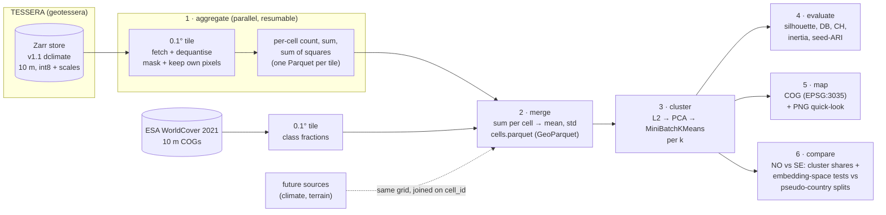

# tessera-nordic

Clustering of [TESSERA](https://github.com/ucam-eo/tessera) satellite embeddings over
**Norway and Sweden**, to study how the data is distributed across the two countries.

TESSERA is an open Earth-observation foundation model from the University of
Cambridge. It provides annual, 128-dimensional embeddings at 10 m resolution, derived
from Sentinel-1 and Sentinel-2 time series. This repository aggregates those
embeddings to a 1 km equal-area grid (EPSG:3035, aligned with the EEA reference grid),
clusters the cells and maps the result. It starts with a small pilot area and then
scales to both countries.

The repository contains **code only**. No data is stored here (see
[Data and licence](#data-and-licence)).

## Pipeline



| Stage | Command | Output |
|---|---|---|
| 1 aggregate | `tessera-nordic aggregate CONFIG` | `${TN_DATA_DIR}/stats/<key>/tiles/*.parquet`, `manifest.jsonl`; `aggregate_summary.json` in the run |
| 2 merge | `tessera-nordic merge CONFIG` | `cells.parquet`: `cell_id`, `cell_code`, `x`, `y`, `tessera_count`, `tessera_mean_000…127`, `tessera_std_000…127`, point geometry; with WorldCover also `worldcover_mean_000…010` (class fractions, order in `provenance.json`); optional water filter |
| 3 cluster | `tessera-nordic cluster CONFIG` | `cluster/preprocess.joblib`, `model_k<k>.joblib`, `labels.parquet`, `pca_explained_variance.csv` |
| 4 evaluate | `tessera-nordic evaluate CONFIG` | `evaluate/metrics.csv`, `metrics_vs_k.png`, `pca_explained_variance.png` |
| 5 map | `tessera-nordic map CONFIG` | `map/clusters_k<k>.tif` (COG), `map/clusters_k<k>.png` |
| 6 compare | `tessera-nordic compare CONFIG` | `compare/summary.csv` (JSD, overlap, within-country baselines, shared/country-specific clusters per k), `cluster_shares.csv`, `distribution_summary.csv` + `reference_percentiles.csv` (embedding-space tests vs pseudo-country splits), plots |
| all | `tessera-nordic run CONFIG` | all of the above in one run directory (compare only if configured) |
| plan | `tessera-nordic plan CONFIG` | tile count and volume estimate, no download |

Every run writes to `${TN_OUTPUT_DIR}/<run_name>/<timestamp>/` together with
`config.resolved.yaml`, `provenance.json` (git commit, package versions, TESSERA
dataset/model/store versions, year, seed, command history) and `run.log`. Stages after
`aggregate` use the latest run directory of that `run_name` unless you pass
`--run-dir`.

Design choices and their reasons (API findings, grid, aggregation method, known
limitations) are in [docs/decisions.md](docs/decisions.md).

## Quickstart

### Laptop

```bash
# 1. Install uv (https://docs.astral.sh/uv/) and the project
curl -LsSf https://astral.sh/uv/install.sh | sh
git clone git@github.com:SINTEF/tessera-nordic.git && cd tessera-nordic
make install

# 2. Point data and outputs OUTSIDE the repository
cp .env.example .env
$EDITOR .env    # TN_DATA_DIR, TN_OUTPUT_DIR, TESSERA_DATA_DIR

# 3. Checks and an end-to-end run on 2 x 2 real tiles (needs network)
make lint test
make smoke
```

The CLI reads `.env` from the working directory; variables already set in the
environment take precedence.

### VM / server (long, unattended runs)

```bash
sudo apt-get install -y git tmux
curl -LsSf https://astral.sh/uv/install.sh | sh
git clone git@github.com:SINTEF/tessera-nordic.git && cd tessera-nordic
uv sync --frozen
cp .env.example .env && $EDITOR .env   # e.g. /srv/tessera-nordic/{data,outputs,tessera}

tmux new -s tn            # detach with Ctrl-b d, reattach with: tmux attach -t tn
make pilot                # or: make full
```

Runs are resumable: if the VM restarts or the job is killed, start the same command
again. Finished tiles are listed in `${TN_DATA_DIR}/stats/<key>/manifest.jsonl` and are
skipped. Tiles that still fail after all retries are listed in
`aggregate_summary.json`, and the command exits non-zero so you notice; rerun to retry
only those. Progress and an ETA are logged every 30 s to the console and to the run's
`run.log`.

### Docker

```bash
make docker-build      # docker build --build-arg GIT_COMMIT=... -t tessera-nordic:latest .

docker run --rm \
  -v /srv/tn/data:/data -v /srv/tn/outputs:/outputs -v /srv/tn/tessera:/tessera \
  tessera-nordic:latest run configs/smoke.yaml
```

The image's entry point is the CLI, so any stage works (`aggregate configs/pilot.yaml`,
`map configs/pilot.yaml --run-dir /outputs/pilot/<timestamp>`, …). Inside the container
the three directories are `/data`, `/outputs` and `/tessera`; mount host directories
there. To use your own config, mount it as well (`-v $PWD/my.yaml:/app/configs/my.yaml`).

## Comparing Norway and Sweden

The research question is whether the two countries' embeddings are distributed
similarly. All cells of both countries go through **one shared clustering**, and the
`compare` stage then compares the countries' distributions over those clusters:

- the share of each country's cells in every cluster, with 95% intervals from a
  spatial block bootstrap (cells are autocorrelated, so 50 km blocks are resampled);
- the Jensen–Shannon divergence (0 = identical, 1 = disjoint) and the histogram
  overlap between the two distributions;
- a **within-country baseline**: the same divergence between two random halves of one
  country. Two countries are "as similar as the two halves of one country" when the
  size-matched `jsd_between_halves` sits within the `jsd_within_*` baselines;
- the clusters that are shared and those that occur in only one country;

Cluster shares depend on `k` and on one clustering, so the stage also compares the
countries **directly in embedding space** (L2-normalised, PCA), in
`compare/distribution_summary.csv`:

| Statistic | Reads as |
|---|---|
| `c2st_auc` | Classifier two-sample test: can a classifier tell the countries apart on held-out 50 km blocks? 0.5 = indistinguishable, 1 = always. |
| `tv_lower_bound` | At least this share of the two distributions does not overlap (`|2·balanced accuracy − 1|`). |
| `energy`, `mmd2`, `swd` | Energy distance, kernel MMD² and sliced Wasserstein-1 distance (embedding units). |
| `uncovered_a`, `uncovered_b` | Share of one country's cells with no counterpart in the other (k-NN coverage): "same landscape types in other proportions" vs "types found in only one country". |
| `jsd_k<k>` | The cluster-share JSD, for comparison. |

Every statistic is "higher = more different", and comes with two reference scales:

- **within block halves**: one country split into two random halves of its 50 km
  blocks (same distribution, different places);
- **pseudo-countries**: the pooled area cut by straight lines at 24 angles into two
  regions with the Norway/Sweden size ratio, and each country cut by lines into two
  halves. `reference_percentiles.csv` gives the percentile of the real pair among
  them, i.e. whether the national border separates the landscape more or less than an
  arbitrary line. `reference.png` shows all of them in one figure.

Maps: `c2st_map.png` (how Swedish-looking each cell is, out of fold) and
`coverage_map.png` (cells without a counterpart in the other country);
`coverage_by_cluster.csv` lists which clusters those cells belong to.

On the 5% sample, with or without water cells, Norway and Sweden are clearly
distinguishable (classifier AUC 0.96–0.97), but no more so than two regions on either
side of a random straight line through Fennoscandia: the real pair sits at the
20th–45th percentile of the line splits. Details in
[docs/decisions.md](docs/decisions.md#6-comparing-the-two-countries-distributions).

`configs/sample.yaml` runs this on a seeded random 5% of all tiles, which is enough to
estimate each country's distribution. `configs/full.yaml` runs it on everything.

## Configuration

One YAML file per run, validated by pydantic (unknown keys are rejected). The
shipped configs are:

| Config | Area | Purpose |
|---|---|---|
| [`configs/smoke.yaml`](configs/smoke.yaml) | 2 × 2 tiles around Trondheim | quick end-to-end check |
| [`configs/pilot.yaml`](configs/pilot.yaml) | lon 10–12, lat 63.2–63.6: Trøndelag coast → mountains → Jämtland border | first analysis; comments show how to widen it east into Jämtland |
| [`configs/sample.yaml`](configs/sample.yaml) | seeded random 5% of the Norway + Sweden tiles | country-scale distribution comparison at ~1/20 of the cost |
| [`configs/full.yaml`](configs/full.yaml) | mainland Norway + Sweden from a boundary polygon | full study |

Every config sets the run name, area, year (2024), embedding version and variant, grid
CRS and cell size, minimum pixel count, workers, `keep_raw`, PCA settings, clustering
settings (`k` can be a single value or a sweep) and the seed.

### Country boundaries

`full.yaml` needs a country-boundary file, which is **not** committed. Download it
into `${TN_DATA_DIR}/boundaries/`:

- **GISCO (Eurostat), recommended:** *Countries 2020*, scale 1:1 million, EPSG:4326,
  GeoPackage (`CNTR_RG_01M_2020_4326.gpkg`), from
  <https://ec.europa.eu/eurostat/web/gisco/geodata/administrative-units/countries>.
  Features are selected with `column: CNTR_ID`, `values: ["NO", "SE"]`. Check the
  GISCO copyright notice on that page.
- **Natural Earth, alternative (public domain):** *Admin 0 – Countries*, 1:10m, from
  <https://www.naturalearthdata.com/downloads/10m-cultural-vectors/>. Use
  `column: ADM0_A3`, `values: ["NOR", "SWE"]`.

Quote `"NO"` in YAML: unquoted, `NO` is read as the boolean `false`. The `clip_bbox` in
`full.yaml` removes Svalbard and Jan Mayen in case the file includes them.

## Data volumes and sizing

TESSERA tiles are 0.1° × 0.1°. At 63° N one tile is about 5 × 11 km, 1125 × 522
pixels, and about 77 MB as int8 embeddings plus scales. Tiles get narrower further
north. **Network transfer is ~3.4× larger than that** (240–320 MB per tile, measured
2026-11-28 with background traffic subtracted): the store packs 32 × 32-pixel chunks
into 4096 × 4096-pixel shards, and reading a 0.1° window out of a shard fetches more
than the window. The default `zarr` backend streams each tile and keeps nothing on
disk unless `keep_raw: true`. The per-tile statistics are small (about 300 kB per
tile, measured).

| Run | Tiles | Network transfer | 1 km cells | Stats cache | Runtime |
|---|---|---|---|---|---|
| smoke (measured) | 4 | ~1 GB | 230 | 1.2 MB | 51 s end to end, 2 workers |
| pilot (measured) | 80 | ~20 GB | 4 480 | 24 MB | 6.5 min end to end, 4 workers (~12 tiles/min) |
| sample, 5% of NO + SE (measured) | 793 | ~0.2 TB | 48 992; 37 984 after the water filter | ~240 MB | 55 min aggregate on a laptop, 8 workers (~14.6 tiles/min); compare 15–33 min |
| full (NO + SE) | 15 863 (`make plan-full`) | ~4 TB | ~0.98 M; ~0.76 M after the water filter (×20 the sample) | ~5 GB | laptop: ~15 h at the measured 17 tiles/min (12 workers, ~70 MB/s) |

The full-run tile count comes from `make plan-full` with the GISCO boundary (an upper
bound: open-sea tiles carry no data); the full-run cell counts scale the sample by 20.
Throughput is set by bandwidth: 17 tiles/min × 260 MB ≈ 70 MB/s (~600 Mbit/s).

**Memory:** each worker holds one quantised tile plus working arrays, about
0.5–1 GB peak. The merge of the full run holds all cell statistics in memory, about
5–8 GB. Clustering and comparing ~0.8 M cells × 16 PCA components is light; the
comparison caps its per-group samples (`compare.max_cells_per_group`).

**Suggested VM for the full run:** 16–32 vCPU, 32 GB RAM, 50 GB disk (outputs,
cache, logs; add ~1.3 TB only for `keep_raw: true`), and ≥ 1 Gbit/s to the internet.
The store is served from Source Cooperative (AWS us-west-2 behind a CDN), so a VM
with a fast uplink in any region works. At 1 Gbit/s sustained the ~4 TB take about
9 h; at ~600 Mbit/s (our laptop) about 15 h. Check the VM provider's ingress costs
(usually free) and any data cap.

### Input quality and resolution

- **Native resolution:** 10 m pixels, one 128-d embedding per pixel per year (2024),
  learned from the full Sentinel-1 + Sentinel-2 time series of that year.
- **Quantisation:** int8 with a per-pixel float scale; the median step is ~3% of a
  value, but averaging ~10 000 pixels per cell removes it at 1 km.
- **1 km aggregation:** a full cell averages ~10 000 pixels (median 9 991; 25% of
  cells, at coasts and borders, have fewer than 7 770; cells under 2 500 are dropped).
  About half of the pixel-level variance (48%, 28–68% per band) lies *within* cells,
  so a 1 km mean describes a landscape mixture, not a land-cover class. The per-cell
  standard deviations are kept in `cells.parquet` but not used for clustering.
- **Observation density differs by region** (median clear Sentinel-2 observations
  per pixel in 2024): Bergen coast 33, Trondheim 45, Skåne 49, Kiruna mountains 57,
  Norrbotten 65, Lofoten 70, Dalarna 78, Finnmark 79. Northern sites lack winter
  months (polar night), the west coast of Norway is cloudy. Embeddings may carry some
  of that input difference; the store's `s2_obs_count` / `s1_*_obs_count` could be
  added as a covariate source.

## Data and licence

- **Code:** Apache-2.0 (see [LICENSE](LICENSE)). This repository contains code
  only. Embeddings, derived statistics, maps and boundary files are written to the
  directories named in `.env` and are never committed.
- **TESSERA embeddings** are produced by the University of Cambridge
  ([ucam-eo/tessera](https://github.com/ucam-eo/tessera)) and accessed with
  [geotessera](https://github.com/ucam-eo/geotessera). According to the upstream
  README ([License](https://github.com/ucam-eo/tessera#license) and
  [Terms of Use](https://github.com/ucam-eo/tessera#aup) sections), TESSERA data and
  embeddings are released under **CC0**
  ([CC0 1.0](https://creativecommons.org/publicdomain/zero/1.0/)); attribution is not
  legally required but is requested, and the README sets out intended uses and
  ethical guidelines. The TESSERA software and geotessera are MIT-licensed.
- **Please cite** the TESSERA paper:

  > Z. Feng, C. Atzberger, S. Jaffer, J. Knezevic, S. Sormunen, R. Young, M. C. Lisaius,
  > M. Immitzer, D. A. Coomes, A. Madhavapeddy, A. Blake, S. Keshav (2025).
  > *TESSERA: Temporal Embeddings of Surface Spectra for Earth Representation and
  > Analysis.* arXiv:2506.20380. <https://arxiv.org/abs/2506.20380>

- TESSERA is derived from Copernicus Sentinel-1 and Sentinel-2 data.
- **ESA WorldCover** (optional `worldcover` source, used for the water filter) is
  released under [CC BY 4.0](https://creativecommons.org/licenses/by/4.0/):
  © ESA WorldCover project 2021 / Contains modified Copernicus Sentinel data (2021)
  processed by ESA WorldCover consortium. Zanaga, D. et al. (2022) *ESA WorldCover 10 m
  2021 v200*, doi:[10.5281/zenodo.7254221](https://doi.org/10.5281/zenodo.7254221).
  It is read window by window from the public AWS bucket; nothing is stored except the
  per-cell fractions.
- Country boundaries: see [Country boundaries](#country-boundaries) for the
  source and its terms.

## Open questions

- **Water is embedded.** The v1.1 land mask was all ones over the fjord and coastal
  tiles we checked, so fjords, lakes and near-shore sea are embedded like land. The
  `worldcover` source and `merge.max_water_fraction` (0.2 in `sample`/`full`) drop
  cells that are mostly water; cells below the threshold still average their water
  pixels in. Masking water per pixel would need WorldCover reprojected onto each
  TESSERA tile.
- **Variant choice.** The default is v1.1 `dclimate` (complete coverage). `cambridge`
  is only published as NPY tiles and does not cover Sweden. TESSERA v2 is in beta;
  switching later means re-running `aggregate` (the cache key changes automatically).
- **Mean pooling** blurs mixed 1 km cells (see `docs/decisions.md`). If this matters,
  the next step is 10 m clustering plus per-cell class fractions.

## Repository layout

```
configs/                 run configs (smoke, pilot, full)
docs/decisions.md        API findings and design decisions
src/tessera_nordic/
  cli.py                 typer CLI (tessera-nordic)
  config.py              pydantic config models
  grid.py, area.py       EPSG:3035 grid, study area and 0.1° tiling
  stats.py               mergeable count / sum / sum-of-squares statistics
  sources/               feature-source interface + TESSERA implementation
  methods.py             clustering-method interface (MiniBatchKMeans)
  pipeline/              aggregate, merge, cluster, evaluate, mapping
tests/                   pytest, synthetic tiles only
```
