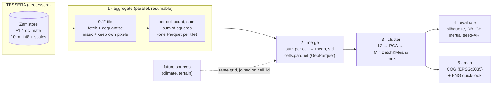

# tessera-nordic

Clustering of [TESSERA](https://github.com/ucam-eo/tessera) satellite embeddings over
**Norway and Sweden**, to study how the data is distributed across the two countries.

TESSERA is an open Earth-observation foundation model from the University of
Cambridge. It provides annual, 128-dimensional embeddings at 10 m resolution, derived
from Sentinel-1 and Sentinel-2 time series. This repository aggregates those
embeddings to a 1 km equal-area grid (EPSG:3035, aligned with the EEA reference grid),
clusters the cells and maps the result. It starts with a small pilot area and then
scales to both countries.

The repository contains **code only**. No data is stored here (see
[Data and licence](#data-and-licence)).

## Pipeline



| Stage | Command | Output |
|---|---|---|
| 1 aggregate | `tessera-nordic aggregate CONFIG` | `${TN_DATA_DIR}/stats/<key>/tiles/*.parquet`, `manifest.jsonl`; `aggregate_summary.json` in the run |
| 2 merge | `tessera-nordic merge CONFIG` | `cells.parquet`: `cell_id`, `cell_code`, `x`, `y`, `tessera_count`, `tessera_mean_000…127`, `tessera_std_000…127`, point geometry |
| 3 cluster | `tessera-nordic cluster CONFIG` | `cluster/preprocess.joblib`, `model_k<k>.joblib`, `labels.parquet`, `pca_explained_variance.csv` |
| 4 evaluate | `tessera-nordic evaluate CONFIG` | `evaluate/metrics.csv`, `metrics_vs_k.png`, `pca_explained_variance.png` |
| 5 map | `tessera-nordic map CONFIG` | `map/clusters_k<k>.tif` (COG), `map/clusters_k<k>.png` |
| all | `tessera-nordic run CONFIG` | all of the above in one run directory |
| plan | `tessera-nordic plan CONFIG` | tile count and volume estimate, no download |

Every run writes to `${TN_OUTPUT_DIR}/<run_name>/<timestamp>/` together with
`config.resolved.yaml`, `provenance.json` (git commit, package versions, TESSERA
dataset/model/store versions, year, seed, command history) and `run.log`. Stages after
`aggregate` use the latest run directory of that `run_name` unless you pass
`--run-dir`.

Design choices and their reasons (API findings, grid, aggregation method, known
limitations) are in [docs/decisions.md](docs/decisions.md).

## Quickstart

### Laptop

```bash
# 1. Install uv (https://docs.astral.sh/uv/) and the project
curl -LsSf https://astral.sh/uv/install.sh | sh
git clone git@github.com:SINTEF/tessera-nordic.git && cd tessera-nordic
make install

# 2. Point data and outputs OUTSIDE the repository
cp .env.example .env
$EDITOR .env    # TN_DATA_DIR, TN_OUTPUT_DIR, TESSERA_DATA_DIR

# 3. Checks and an end-to-end run on 2 x 2 real tiles (needs network)
make lint test
make smoke
```

The CLI reads `.env` from the working directory; variables already set in the
environment take precedence.

### VM / server (long, unattended runs)

```bash
sudo apt-get install -y git tmux
curl -LsSf https://astral.sh/uv/install.sh | sh
git clone git@github.com:SINTEF/tessera-nordic.git && cd tessera-nordic
uv sync --frozen
cp .env.example .env && $EDITOR .env   # e.g. /srv/tessera-nordic/{data,outputs,tessera}

tmux new -s tn            # detach with Ctrl-b d, reattach with: tmux attach -t tn
make pilot                # or: make full
```

Runs are resumable: if the VM restarts or the job is killed, start the same command
again. Finished tiles are listed in `${TN_DATA_DIR}/stats/<key>/manifest.jsonl` and are
skipped. Tiles that still fail after all retries are listed in
`aggregate_summary.json`, and the command exits non-zero so you notice; rerun to retry
only those. Progress and an ETA are logged every 30 s to the console and to the run's
`run.log`.

### Docker

```bash
make docker-build      # docker build --build-arg GIT_COMMIT=... -t tessera-nordic:latest .

docker run --rm \
  -v /srv/tn/data:/data -v /srv/tn/outputs:/outputs -v /srv/tn/tessera:/tessera \
  tessera-nordic:latest run configs/smoke.yaml
```

The image's entry point is the CLI, so any stage works (`aggregate configs/pilot.yaml`,
`map configs/pilot.yaml --run-dir /outputs/pilot/<timestamp>`, …). Inside the container
the three directories are `/data`, `/outputs` and `/tessera`; mount host directories
there. To use your own config, mount it as well (`-v $PWD/my.yaml:/app/configs/my.yaml`).

## Configuration

One YAML file per run, validated by pydantic (unknown keys are rejected). The
shipped configs are:

| Config | Area | Purpose |
|---|---|---|
| [`configs/smoke.yaml`](configs/smoke.yaml) | 2 × 2 tiles around Trondheim | quick end-to-end check |
| [`configs/pilot.yaml`](configs/pilot.yaml) | lon 10–12, lat 63.2–63.6: Trøndelag coast → mountains → Jämtland border | first analysis; comments show how to widen it east into Jämtland |
| [`configs/full.yaml`](configs/full.yaml) | mainland Norway + Sweden from a boundary polygon | full study |

Every config sets the run name, area, year (2024), embedding version and variant, grid
CRS and cell size, minimum pixel count, workers, `keep_raw`, PCA settings, clustering
settings (`k` can be a single value or a sweep) and the seed.

### Country boundaries

`full.yaml` needs a country-boundary file, which is **not** committed. Download it
into `${TN_DATA_DIR}/boundaries/`:

- **GISCO (Eurostat), recommended:** *Countries 2020*, scale 1:1 million, EPSG:4326,
  GeoPackage (`CNTR_RG_01M_2020_4326.gpkg`), from
  <https://ec.europa.eu/eurostat/web/gisco/geodata/administrative-units/countries>.
  Features are selected with `column: CNTR_ID`, `values: ["NO", "SE"]`. Check the
  GISCO copyright notice on that page.
- **Natural Earth, alternative (public domain):** *Admin 0 – Countries*, 1:10m, from
  <https://www.naturalearthdata.com/downloads/10m-cultural-vectors/>. Use
  `column: ADM0_A3`, `values: ["NOR", "SWE"]`.

Quote `"NO"` in YAML: unquoted, `NO` is read as the boolean `false`. The `clip_bbox` in
`full.yaml` removes Svalbard and Jan Mayen in case the file includes them.

## Data volumes and sizing

TESSERA tiles are 0.1° × 0.1°. At 63° N one tile is about 5 × 11 km, 1125 × 522
pixels, and about 77 MB as int8 embeddings plus scales. Tiles get narrower further
north. The default `zarr` backend streams each tile and keeps nothing on disk unless
`keep_raw: true`, which enables a local chunk cache in `TESSERA_DATA_DIR`. The per-tile
statistics are small (about 300 kB per tile, measured).

| Run | Tiles | Streamed | 1 km cells | Stats cache | Typical runtime |
|---|---|---|---|---|---|
| smoke (measured) | 4 | ~0.3 GB | 230 (of 253 before `min_pixel_count`) | 1.2 MB | 51 s end to end, 2 workers (aggregate 40 s) |
| pilot (measured) | 80 | ~6 GB | 4 480 (of 4 565) | 24 MB | 6.5 min end to end, 4 workers (~12 tiles/min) |
| pilot widened (lon 10–15, lat 63–64) | 500 | ~38 GB | ~28 000 | ~150 MB | 1–2 h, 4–8 workers |
| full (NO + SE) | 15 863 (`make plan-full`, GISCO 1:1M) | ~1.2 TB | ~0.8 M | ~5 GB | 1–3 days, 8–16 workers |

The full-run tile count comes from `make plan-full` with the GISCO boundary (an upper
bound: open-sea tiles carry no data); the other full-run numbers are estimates. Throughput is limited by the network:
we measured 8–10 s per tile per worker, but one fetch took 99 s.

**Memory:** each worker holds one quantised tile plus working arrays, about
0.5–1 GB peak. The merge of the full run holds all cell statistics in memory, about
5–8 GB. Clustering 0.8 M cells × 16 PCA components is light.

**Suggested VM for the full run:** 8–16 vCPU, 32 GB RAM, 50 GB disk (outputs, cache,
logs; add about 1 TB only if you set `keep_raw: true`), and a fast, stable connection.
With `workers: 12`, the bottleneck is bandwidth, not CPU. A laptop is fine for smoke
and pilot runs.

## Data and licence

- **Code:** Apache-2.0 (see [LICENSE](LICENSE)). This repository contains code
  only. Embeddings, derived statistics, maps and boundary files are written to the
  directories named in `.env` and are never committed.
- **TESSERA embeddings** are produced by the University of Cambridge
  ([ucam-eo/tessera](https://github.com/ucam-eo/tessera)) and accessed with
  [geotessera](https://github.com/ucam-eo/geotessera). According to the upstream
  README ([License](https://github.com/ucam-eo/tessera#license) and
  [Terms of Use](https://github.com/ucam-eo/tessera#aup) sections), TESSERA data and
  embeddings are released under **CC0**
  ([CC0 1.0](https://creativecommons.org/publicdomain/zero/1.0/)); attribution is not
  legally required but is requested, and the README sets out intended uses and
  ethical guidelines. The TESSERA software and geotessera are MIT-licensed.
- **Please cite** the TESSERA paper:

  > Z. Feng, C. Atzberger, S. Jaffer, J. Knezevic, S. Sormunen, R. Young, M. C. Lisaius,
  > M. Immitzer, D. A. Coomes, A. Madhavapeddy, A. Blake, S. Keshav (2025).
  > *TESSERA: Temporal Embeddings of Surface Spectra for Earth Representation and
  > Analysis.* arXiv:2506.20380. <https://arxiv.org/abs/2506.20380>

- TESSERA is derived from Copernicus Sentinel-1 and Sentinel-2 data.
- Country boundaries: see [Country boundaries](#country-boundaries) for the
  source and its terms.

## Open questions

- **Water is embedded.** The v1.1 land mask was all ones over the fjord and coastal
  tiles we checked, so fjords, lakes and near-shore sea are clustered with the
  land. Should we add an external water mask (for example the EEA or Copernicus water
  layers) as a later feature source, or keep water as its own clusters?
- **Variant choice.** The default is v1.1 `dclimate` (complete coverage). `cambridge`
  is only published as NPY tiles and does not cover Sweden. TESSERA v2 is in beta;
  switching later means re-running `aggregate` (the cache key changes automatically).
- **Mean pooling** blurs mixed 1 km cells (see `docs/decisions.md`). If this matters,
  the next step is 10 m clustering plus per-cell class fractions.

## Repository layout

```
configs/                 run configs (smoke, pilot, full)
docs/decisions.md        API findings and design decisions
src/tessera_nordic/
  cli.py                 typer CLI (tessera-nordic)
  config.py              pydantic config models
  grid.py, area.py       EPSG:3035 grid, study area and 0.1° tiling
  stats.py               mergeable count / sum / sum-of-squares statistics
  sources/               feature-source interface + TESSERA implementation
  methods.py             clustering-method interface (MiniBatchKMeans)
  pipeline/              aggregate, merge, cluster, evaluate, mapping
tests/                   pytest, synthetic tiles only
```
